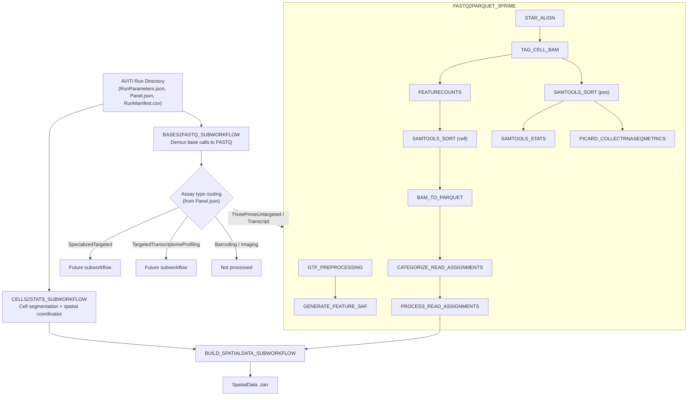

# Workflow Overview

**elembio-multiomics-nf** is a Nextflow pipeline that processes raw sequencing data from the Element Biosciences AVITI spatial transcriptomics platform into spatially-resolved gene expression. Starting from a single AVITI run directory, it performs cell segmentation, base call demultiplexing, genome alignment, read-to-gene assignment, and spatial data integration -- producing a [SpatialData](https://spatialdata.scverse.org/) `.zarr` store as its primary output.

---

## Pipeline Architecture

CELLS2STATS and BASES2FASTQ run **in parallel** from the same run directory. Once BASES2FASTQ completes, FASTQs are routed by assay type (parsed from `Panel.json`) into the appropriate analysis subworkflow. Currently only the 3' untargeted pathway (FASTQ2PARQUET_3PRIME) is implemented. BUILD_SPATIALDATA_SUBWORKFLOW runs last as a separate top-level subworkflow, combining cell coordinates from CELLS2STATS with gene expression parquets from FASTQ2PARQUET_3PRIME.

---

## Subworkflows

### CELLS2STATS_SUBWORKFLOW

Wraps the `cells2stats` tool. Processes AVITI imaging data to identify cell boundaries, extract spatial coordinates (X, Y, Z) for each cell, and produce cell segmentation masks. Key outputs consumed downstream:

| Output | Used By |
|--------|---------|
| `RawCellStats.parquet` | BAM_TO_PARQUET, PROCESS_READ_ASSIGNMENTS (cell position lookup) |
| `Wells/` | BUILD_SPATIALDATA |
| `CellSegmentation/` | BUILD_SPATIALDATA |
| `AnalysisRegion/` | BUILD_SPATIALDATA (overlap runs only) |
| `RunParameters.json`, `Panel.json`, `RunManifest.*` | BUILD_SPATIALDATA (staged into run directory) |

### BASES2FASTQ_SUBWORKFLOW

Wraps the `bases2fastq` tool. Demultiplexes raw base calls into per-sample
FASTQ files organized by well and batch. Outputs:

- **Sample FASTQs** -- routed to analysis subworkflows based on assay type
- **Run metrics** -- `RunStats.json`, index assignment, etc. (no MultiQC in this path)

### FASTQ2PARQUET_3PRIME

The core analysis subworkflow for 3' untargeted spatial transcriptomics. Processes each sample (well + batch) through:

| Step | Tool | Purpose |
|------|------|---------|
| 1 | GTF_PREPROCESSING | bgzip + tabix-index the GTF for IGV/tabix |
| 2 | GENERATE_FEATURE_SAF | Annotate-then-select SAF + intervals/gene metadata |
| 3 | STAR_ALIGN | Align reads to reference genome |
| 4 | TAG_CELL_BAM | Add cell barcode (CB) tags to BAM |
| 5 | FEATURECOUNTS_BAM | Assign reads to SAF features |
| 6 | SAMTOOLS_SORT | Sort BAM by cell barcode and by position |
| 7 | SAMTOOLS_STATS / IDXSTATS / FLAGSTAT | Alignment statistics |
| 8 | PICARD_COLLECTRNASEQMETRICS | Strand / 3′ bias (feeds RunStats) |
| 9 | BAM_TO_PARQUET | Convert BAM records to parquet with spatial coordinates |
| 10 | CATEGORIZE_READ_ASSIGNMENTS | Classify reads (unique, multimapping, counted) |
| 11 | IDENTIFY_FILTERED_POLONIES | Anti-join instrument vs pipeline polonies (optional) |
| 12 | MERGE_POLONY_PARQUETS | Merge aligned + filtered polonies (optional) |
| 13 | PROCESS_READ_ASSIGNMENTS | Generate cell-level count summaries and QC |
| 14 | COLLECT_SAMPLE_METRICS | Per-sample `*.f2p_metrics.json` |
| 15 | AGGREGATE_F2P_METRICS | Run-level `RunStats.json` |
| 16 | F2P_METRICS_DIR | Curated `--f2p-3p-dir` mirror for BUILD_SPATIALDATA |

Steps 1–2 run once (not per-sample). Steps 3–14 run per sample in parallel. Steps 15–16 run once after all samples complete. BUILD_SPATIALDATA_SUBWORKFLOW runs after as a separate subworkflow. Operator QC is the cells2stats QC report plus the optional run-quality HTML report (Picard HS, FastQC, and f2p MultiQC were retired in 1.10.0).

### BUILD_SPATIALDATA_SUBWORKFLOW

A separate top-level subworkflow (not part of FASTQ2PARQUET_3PRIME). Combines spatial coordinates and cell segmentation (from CELLS2STATS) with gene expression parquets (from FASTQ2PARQUET_3PRIME) into a single [SpatialData](https://spatialdata.scverse.org/) `.zarr` store. Also syncs Projection images from S3 and merges data across wells and batches.

---

## Inputs

| Input | Required | Description |
|-------|----------|-------------|
| `--run_dir` | Yes | Path to AVITI run directory (local or S3). Must contain `RunParameters.json`, `RunManifest.csv`, and `Panel.json`. |
| `--genome` | No | Reference genome key (default: `GRCh38`). Selects the FASTA, STAR index, GENCODE GTF and BED12. |
| `--genes_gtf` | No | Replaces the genome's GENCODE GTF with another annotation on the same assembly. |
| `--igenomes_ignore` | No | Custom references instead: set `true` and pass `--fasta`, `--star_index` and `--genes_gtf` together. |

Run-level override files (`tca_manifest_csv`, `c2s_panel_json`, `b2f_panel_json`, etc.) are documented in [parameters.md](parameters.md). The shared TCA fans out to cells2stats and bases2fastq; schema-hidden per-tool TCA overrides remain available for engineering use.

---

## Outputs

| Directory | Contents |
|-----------|----------|
| `cells2stats/` | Cell spatial coordinates (`RawCellStats.parquet`), segmentation masks, wells, QC reports |
| `bases2fastq/` | Demultiplexed FASTQs, run metrics |
| `fastq2parquet_3prime/genes/` | Compressed/indexed GTF provenance |
| `fastq2parquet_3prime/feature_set/` | Counting SAF + IGV beds |
| `fastq2parquet_3prime/Samples/{sample}/` | STAR BAMs, featureCounts, polony parquets, Picard RNA metrics, samtools |
| `spatialdata/` | `{run_id}.zarr/` or `{run_id}.zarr.zip` -- the final SpatialData store |
| `pipeline_info/` | Provenance, Nextflow execution trace and report |

For detailed output descriptions and file-level documentation, see [outputs.md](outputs.md).

---

## Assay Type Routing

The pipeline reads `Panel.json` from the run directory to determine how each sequencing batch maps to an assay type. Batches are extracted from three sections:

- **DISSPrimerTubes** -- primary assay batches (e.g., `ThreePrimeUntargeted`, `SpecializedTargeted`)
- **BarcodingPrimerTubes** -- barcoding batches
- **ImagingPrimerTubes** -- imaging batches

After BASES2FASTQ produces FASTQs, each sample's batch is looked up in this mapping and routed to the corresponding analysis channel:

| Assay Types | Channel | Status |
|-------------|---------|--------|
| `ThreePrimeUntargeted`, `Transcript` | FASTQ2PARQUET_3PRIME | Implemented |
| `SpecializedTargeted` | (future subworkflow) | Planned |
| `TargetedTranscriptomeProfiling` | (future subworkflow) | Planned |
| `Barcoding`, `Imaging`, others | Not processed | -- |

The type lists are configurable via `f2p_three_prime_types`, `f2p_specialized_types`, and `f2p_targeted_tx_types` parameters.

---

## Tile and Batch Filtering

Two shared filtering parameters restrict which data is processed:

| Parameter | Scope | Description |
|-----------|-------|-------------|
| `tile` | c2s, b2f, build_spatialdata | List of tile ID regex patterns (e.g., `["L1R17C04S1"]`, `["L2R0[1-3]C0[1-4]S1"]`). Applied as `--tile` in c2s, `-i` include in b2f (with auto-exclude), and `--tile-filter` in build_spatialdata via RunParameters.json tile resolution. |
| `filter_batch` | c2s, b2f | Comma-delimited batch names (e.g., `B01,B02`). Applied as `--batch` in both tools. |
| `segmentation_dir` | c2s (b2f planned) | Custom cell segmentation directory. Currently passed to cells2stats via `--segmentation`. Will also be passed to bases2fastq when CLI support is added. |
| `analysis_region_dir` | build-spatialdata | Custom AnalysisRegion directory override for the overlap-aware stitcher. Cells2stats still reads `{run_dir}/AnalysisRegion` — the override is SD-build-only. Ignored on non-overlap runs. |

When `tile` is set, the pipeline resolves regex patterns against the canonical tile list in `RunParameters.json` to ensure consistent filtering across all stages.

---

## Further Reading

- [parameters.md](parameters.md) -- Complete parameter reference
- [usage.md](usage.md) -- Practical usage examples and configuration guides
- [outputs.md](outputs.md) -- Detailed output directory structure and file descriptions
- [../CITATIONS.md](../CITATIONS.md) -- tools and references to cite, including the elembio-diss-tools repository
